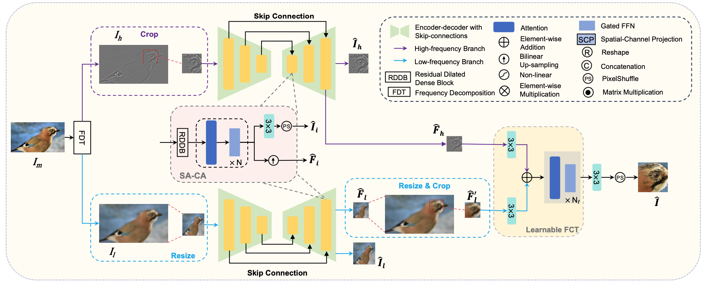
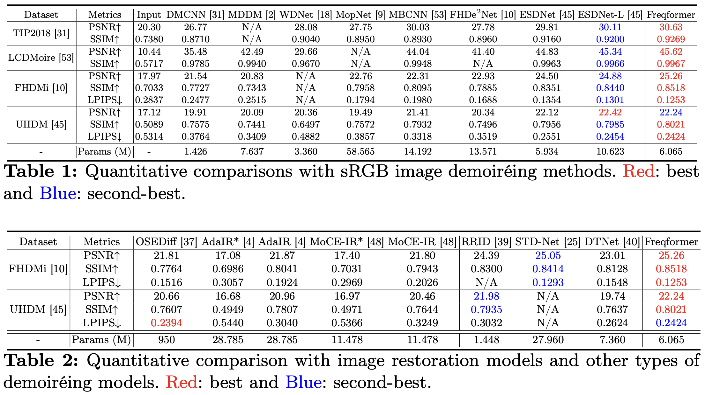

# Freqformer: Image-Demoiréing Transformer via Effective Frequency Decomposition

[Xiaoyang Liu](https://xyliu339.github.io/), [Bolin Qiu](https://github.com/BolinQiu), [Zheng Chen](https://zhengchen1999.github.io/), [Libo Zhu](https://libozhu.com/), [Zihan Zhou](https://github.com/ZZH-qwq), [Kai Liu](https://kai-liu.cn/), [Jiezhang Cao](https://www.jiezhangcao.com/) and [Yulun Zhang](http://yulunzhang.com/), "Freqformer: Image-Demoiréing Transformer via Effective Frequency Decomposition", ECCV, 2026.

[](https://github.com/xyLiu339/Freqformer/releases) 
[](https://github.com/xyLiu339/Freqformer) 
[](https://github.com/xyLiu339/Freqformer) 

[[ArXiv](http://arxiv.org/abs/2505.19120)] [[Supplementary material](https://github.com/xyLiu339/Freqformer/releases)] [[ECCV proceedings](https://link.springer.com/chapter/10.1007/978-3-032-37083-9_4)]

---

> **Abstract:** Image demoiréing remains a challenging task due to the complex interplay between texture corruption and color distortions caused by moiré patterns. Existing methods, especially those relying on direct image-to-image restoration, often fail to disentangle these intertwined artifacts effectively. While frequency-aware approaches offer a promising direction, their potential is hindered by the discrete transform (e.g., Haar wavelet or block-based DCT), which may suffer from spatial discontinuity, channel redundancy, and further cause error accumulation during their fixed inverse processes. In this paper, we present Freqformer, a Transformer-based framework specifically designed for image demoiréing through targeted frequency separation. Our method performs an effective frequency decomposition that splits moiré patterns into high-frequency spatially-localized textures and low-frequency scale-robust color distortions, which are then handled by a dual-branch architecture and an asymmetric training scheme tailored to their distinct characteristics. We further propose a learnable Frequency Composition Transform (FCT) module to adaptively fuse the frequency-specific outputs, enabling consistent and high-fidelity reconstruction. To better aggregate the spatial dependencies and the inter-channel complementary information, we introduce a Spatial-Aware Channel Attention (SA-CA) module that refines moiré-sensitive regions without incurring high computational cost. Extensive experiments on various demoiréing benchmarks demonstrate that Freqformer achieves state-of-the-art performance with a compact model size.

<div align=center>
    
</div>

<div align=center>
    
</div>


---

## <a name="testing"></a> 🧰 Models and Scripts

| Dataset | Default pretrained checkpoint |
| --- | --- |
| TIP2018 | `./pretrained/checkpoint_tip_000070.tar` |
| LCDMoire (AIM) | `./pretrained/checkpoint_aim_000120.tar` |
| FHDMi | `./pretrained/checkpoint_fhdmi_000150.tar` |
| UHDM | `./pretrained/checkpoint_uhdm_000040.tar` |

Run the evaluation from the repository root with the configuration for your dataset.

```bash
python test.py --config config/xxx_test.yaml
```

Replace `xxx` with the identifier below.

| Dataset | `xxx` | Expected test image layout |
| --- | --- | --- |
| TIP2018 | `tip` | Paired PNGs in `source/` and `target/` |
| LCDMoire (AIM) | `aim` | Paired PNGs in `moire/` and `clear/` |
| FHDMi | `fhdmi` | Paired PNGs in `source/` and `target/` |
| UHDM | `uhdm` | Each `*_moire.jpg` and its `*_gt.jpg` in the same directory |

Before running, edit the corresponding YAML file in [`config/`](config/).

- `GPU_ID` selects the CUDA device.
- `TEST_DATASET` points to the root of the paired moiré and ground-truth test images.
- `LOAD_PATH` points to the pretrained checkpoint.
- `SAVE_PREFIX` and `EXP_NAME` set the output directory to `<SAVE_PREFIX>/<EXP_NAME>/test_result/`. Set `SAVE_IMG` to `png` or `jpg` to save restored images. The default `False` disables image saving.

❗❗ Reference evaluation logs are available in [`reprodeuction_ref/`](reprodeuction_ref/) for comparison with your results.

## 🔗 Contents

- [x] [Models](#testing)
- [ ] Training
- [x] [Testing](#testing)
- [x] [Results](#results)
- [x] [Citation](#citation)
- [x] [Acknowledgements](#acknowledgements)


## <a name="results"></a>🔎 Results
<details open>
<summary>Quantitative Results </summary>


<div align=center>
    
</div>

</details>


<details open>
<summary>Visual Results on FHDMi and UHDM </summary>

<div align=center>
    
</div>

<div align=center>
    
</div>

</details>


### <a name="citation"></a>📎 Citation
```
@InProceedings{liu2026freqformer,
    title={Freqformer: Image-Demoir\'eing Transformer via Effective Frequency Decomposition},
    author={Liu, Xiaoyang and Qiu, Bolin and Chen, Zheng and Zhu, Libo and Zhou, Zihan and Liu, Kai and Cao, Jiezhang and Zhang, Yulun},
    booktitle={ECCV},
    year={2026},
}

@article{liu2025freqformer,
    title={Freqformer: Image-Demoir\'eing Transformer via Efficient Frequency Decomposition},
    author={Liu, Xiaoyang and Qiu, Bolin and Cao, Jiezhang and Chen, Zheng and Zhang, Yulun and Yang, Xiaokang},
    journal={arXiv preprint arXiv:2505.19120},
    year={2025},
}
```

### <a name="acknowledgements"></a>💡 Acknowledgements

We thank the Restormer authors for their Transformer implementation and the UHDM authors for their ESDNet code and evaluation pipeline. [Restormer](https://github.com/swz30/Restormer) · [UHDM](https://github.com/CVMI-Lab/UHDM)
